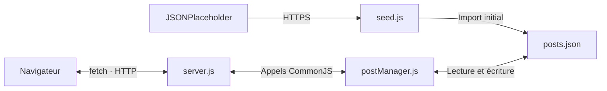

# TP Node.js — API REST de gestion des publications

Ce compte rendu présente la réalisation d’une API REST et de son interface web, **Journal des posts**. Le projet importe 100 publications de JSONPlaceholder, permet de les consulter, de les créer, de les modifier et de les supprimer, puis conserve les changements dans un fichier JSON.

## 1. Objectifs du TP

- Organiser un projet Node.js avec les modules CommonJS (`require` et `module.exports`).
- Récupérer des données distantes avec `https` et les stocker localement avec `fs`.
- Créer un serveur avec le module natif `http` et associer chaque opération CRUD à une route REST.
- Consommer l’API depuis une page HTML avec `fetch` et vérifier ses réponses avec un client HTTP.

## 2. Exécution locale

Le projet requiert Node.js 14 ou plus récent, conformément à l’énoncé. Il utilise les modules natifs de Node.js et ne nécessite aucune installation de dépendances.

```sh
git clone https://github.com/Anasjarmouni03/TP-Node-JS.git
cd TP-Node-JS/tp-nodejs-api
node server.js
```

Ouvrir [http://localhost:3000](http://localhost:3000/) dans un navigateur. L’API est accessible sur [/api/posts](http://localhost:3000/api/posts). Le fichier `posts.json` fourni permet de démarrer sans accès à Internet.

`npm start` lance aussi le serveur. Si le port 3000 est occupé, exécuter `PORT=3001 node server.js` dans un terminal macOS ou Linux, puis utiliser `http://localhost:3001`.

Pour recharger les données d’origine, arrêter le serveur puis lancer `node seed.js` ou `npm run seed`. Cette commande nécessite Internet et **remplace les données locales**, y compris les modifications faites depuis l’interface.

## 3. Organisation du projet

```text
TP-Node-JS/
├── README.md
└── tp-nodejs-api/
    ├── package.json        # Configuration et commandes npm
    ├── seed.js             # Import des publications par HTTPS
    ├── posts.json          # Données initiales et stockage local
    ├── postManager.js      # Opérations CRUD sur le fichier JSON
    ├── server.js           # Serveur HTTP et routage de l’API
    ├── api-tests.http      # Requêtes pour VS Code REST Client
    └── client/
        └── index.html     # Interface HTML, CSS et JavaScript
```



## 4. Réalisation

### Import des données

`seed.js` envoie une requête avec `https.get`, lit la réponse en UTF-8 et analyse le JSON. Le script attend un statut `200` et un tableau contenant au moins une publication. Il effectue jusqu’à trois tentatives, chacune limitée à huit secondes. Une fois la réponse validée, il écrit les données dans un fichier temporaire, puis remplace `posts.json`. Si l’import échoue, il affiche l’erreur et se termine avec un code de sortie non nul.

Les données de démonstration proviennent de l’API publique de JSONPlaceholder. [Consulter les données d’origine](https://jsonplaceholder.typicode.com/posts)

### Gestion des publications

`postManager.js` exporte `getAllPosts`, `getPost`, `insertPost`, `updatePost` et `deletePost`. Le module lit le fichier avec `fs.readFile`, transforme le JSON en tableau et signale les erreurs au serveur par des fonctions de rappel.

Lors d’une création, le nouvel identifiant vaut le plus grand identifiant présent plus un, ou `1` si la liste est vide. Une mise à jour remplace les champs de la publication et conserve l’identifiant de l’URL. Le module traite les écritures l’une après l’autre dans le processus Node.js pour éviter que deux requêtes simultanées écrasent leurs changements. Il sauvegarde chaque modification dans un fichier temporaire, puis renomme ce fichier pour que les lecteurs voient toujours une version complète.

### Serveur et contrat HTTP

`server.js` utilise `http.createServer` et choisit la route d’après la méthode et le chemin. Il sert l’interface sur `/` et l’API sous `/api/posts`. Les réponses de l’API utilisent le format JSON, sauf les réponses `204` qui sont vides.

| Méthode | Route | Opération | Réponse en cas de succès |
| --- | --- | --- | --- |
| `GET` | `/api/posts` | Lister les publications | `200 OK` et un tableau JSON |
| `GET` | `/api/posts/:id` | Lire une publication | `200 OK` et la publication |
| `POST` | `/api/posts` | Créer une publication | `201 Created`, la publication et son URL dans `Location` |
| `PUT` | `/api/posts/:id` | Remplacer les champs d’une publication | `200 OK` et la publication modifiée |
| `DELETE` | `/api/posts/:id` | Supprimer une publication | `204 No Content` |

Les requêtes `POST` et `PUT` utilisent un corps JSON. L’API exige un entier positif pour `userId` et deux chaînes non vides pour `title` et `body`. Elle retire les espaces autour des deux chaînes. Le serveur fixe lui-même l’identifiant de la ressource.

```json
{
  "userId": 1,
  "title": "Première publication",
  "body": "Exemple de contenu envoyé à l’API."
}
```

| Code | Situation |
| --- | --- |
| `400 Bad Request` | JSON mal formé ou champs invalides |
| `404 Not Found` | Route ou publication introuvable |
| `405 Method Not Allowed` | Méthode non prise en charge sur cette route |
| `413 Content Too Large` | Corps de requête supérieur à 64 Kio |
| `500 Internal Server Error` | Échec de lecture, de traitement ou de sauvegarde du fichier |

Le serveur répond également aux requêtes CORS `OPTIONS` sur les routes de l’API avec un statut `204`.

### Interface web

`client/index.html` affiche les publications par identifiant décroissant et permet de filtrer la liste par identifiant, titre ou contenu. Le formulaire sert à la création et à la modification. Avant de modifier un post, l’interface récupère son contenu par son identifiant. La suppression demande une confirmation. Les erreurs de l’API apparaissent dans la page. La mise en page s’adapte à la largeur de l’écran.

## 5. Tests et résultats

### Reproduire les tests

Après avoir lancé le serveur, ouvrir [api-tests.http](tp-nodejs-api/api-tests.http) dans VS Code avec l’extension REST Client et exécuter les requêtes dans l’ordre. Les requêtes de modification, de suppression et de vérification réutilisent l’identifiant renvoyé par la requête nommée `createPost`. Le scénario crée puis supprime sa propre publication de test.

Le scénario CRUD peut aussi être exécuté dans un terminal avec `curl`. Chaque réponse est affichée avec son statut, sauf la création dont le corps sert à récupérer l’identifiant.

```sh
base_url=http://localhost:3000/api/posts
curl -isS -w '\n' "$base_url"
curl -isS -w '\n' "$base_url/1"

post_id=$(curl -fsS -X POST "$base_url" \
  -H 'Content-Type: application/json' \
  -d '{"userId":1,"title":"Post de test","body":"Contenu initial."}' |
  node -pe 'JSON.parse(require("fs").readFileSync(0, "utf8")).id')

curl -isS -w '\n' -X PUT "$base_url/$post_id" \
  -H 'Content-Type: application/json' \
  -d '{"userId":1,"title":"Post modifié","body":"Contenu mis à jour."}'
curl -isS -w '\n' -X DELETE "$base_url/$post_id"
curl -isS -w '\n' "$base_url/$post_id"
```

### Vérifications effectuées

| Test | Résultat observé |
| --- | --- |
| Import des données de démonstration | 100 publications enregistrées dans `posts.json` |
| Liste et détail | `200` avec les 100 publications initiales, puis `200` pour la publication demandée |
| Création | `201`, identifiant attribué par le serveur et en-tête `Location` |
| Modification | `200`, champs mis à jour et identifiant conservé |
| Suppression | `204` sans corps, puis `404` à la consultation de la publication supprimée |
| Requêtes invalides | `400` pour un JSON ou un champ invalide et `413` pour un corps trop volumineux |
| Écritures simultanées | Huit créations parallèles enregistrées avec huit identifiants distincts |
| Persistance | La modification et la suppression restent visibles après redémarrage du serveur |
| Navigateur Chrome | Affichage, recherche, création, modification, suppression et mise en page mobile vérifiés |

## 6. Bilan

Le TP couvre le trajet complet d’une publication, de l’import initial à sa modification depuis le navigateur. L’organisation en modules sépare le traitement HTTP de l’accès aux données. Le stockage dans un fichier permet d’observer directement les écritures et de vérifier la persistance après redémarrage. Chaque modification réécrit le fichier JSON entier et la file d’écriture s’applique à un seul processus Node.js. Ce fonctionnement correspond à une application locale de démonstration.
